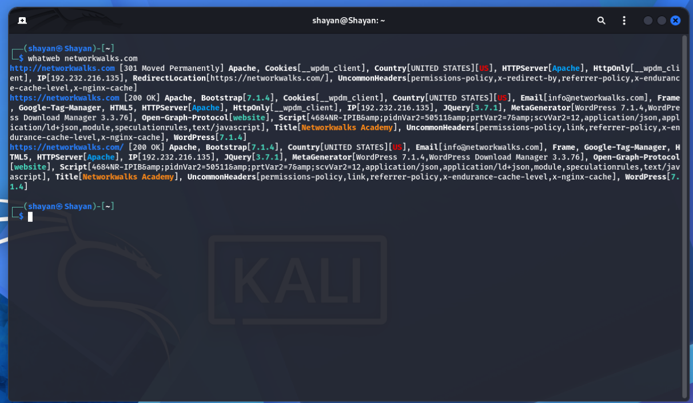
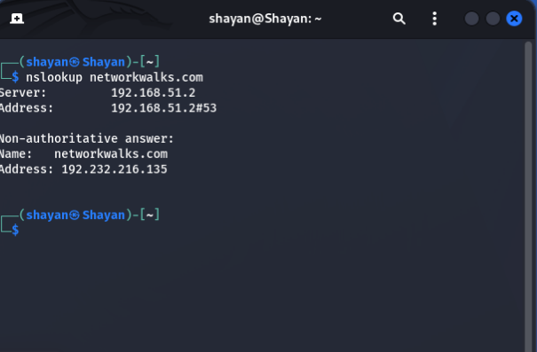
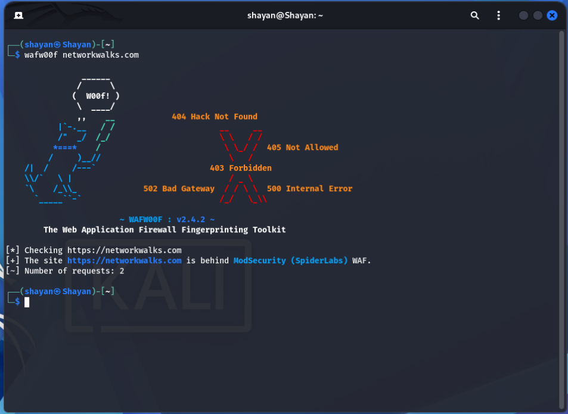
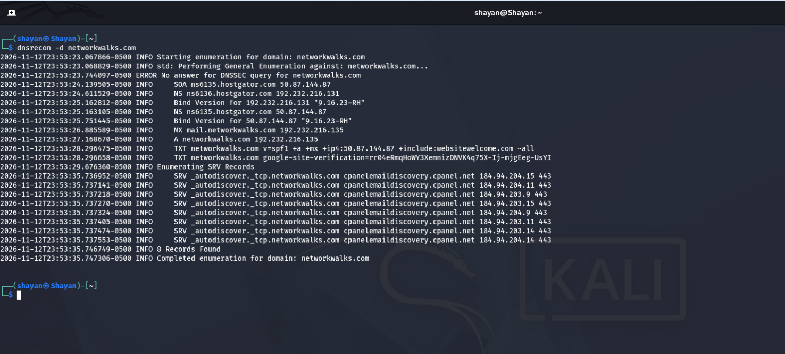

# Week 2: Footprinting, Reconnaissance & Network Scanning (W2-PM-FINAL)

**Author:** Shayan Rafiq  
**Program:** Cybersecurity & Ethical Hacking Program – Networkwalks  
**Modules Covered:** W2-PM1 (Kali Linux OSINT & Reconnaissance) & W2-PM5 (Zenmap Local Network Scanning)  

---

## 📄 Full Report
[Download Penetration Testing Report (.docx)](./W2-PM-FINAl%20Pentester_Report_Shayan_Rafiq.docx)

---

## 🔍 Phase 1: Footprinting & Reconnaissance (`networkwalks.com` — Authorized Scope)

### 1. Web Technology Fingerprinting (`WhatWeb`)
Identified Apache web server, WordPress 7.1.4, WordPress Download Manager 3.3.76, Bootstrap 7.1.4, and jQuery 3.7.1.

### 2. DNS Name Resolution (`nslookup`)
Resolved `networkwalks.com` to its public IPv4 address `192.232.216.135`.

### 3. HTTP Response Headers (`curl -I`)
Inspected HTTP/2 200 OK headers, caching layers, cookies, and exposed WordPress REST API (`/wp-json/`).

### 4. Web Application Firewall Detection (`wafw00f`)
Verified perimeter protection behind **ModSecurity (SpiderLabs) WAF**.

### 5. DNS Record Enumeration (`dnsrecon`)
Enumerated HostGator name servers, BIND `9.16.23-RH`, mail/SPF records, missing DNSSEC, and 8 cPanel autodiscover SRV records.

### 6. Visual OSINT Link Analysis (`Maltego Desktop`)
Mapped entity relationships between `networkwalks.com` and `info@networkwalks.com`.

### 7. Automated OSINT Harvesting (`theHarvester`)
Demonstrated multi-source public OSINT collection workflows in Kali Linux.

---

## 🖥️ Phase 2: Active Network Discovery (`192.168.1.0/24` — Local Lab)

### 8. Local Subnet Ping Scan (`Zenmap`)
Scanned `192.168.1.0/24` (`nmap -sn`), discovering **7 live hosts** and mapping their MAC addresses/vendors.

### 9. Local Network Topology (`Zenmap Fisheye View`)
Generated a graphical star-topology map connecting `localhost` (`192.168.1.102`) to neighboring LAN hosts.

